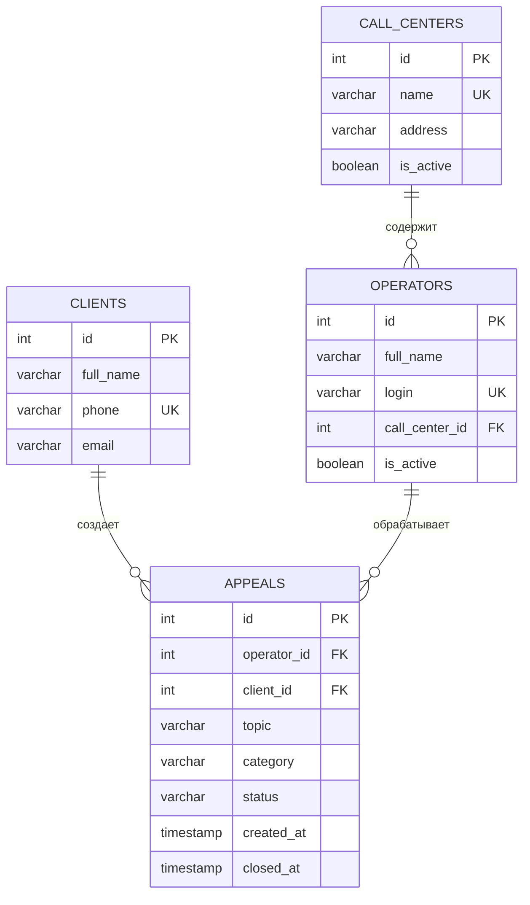

# Информационная система колл-центра (КР №2, JavaFX)

Настольное приложение на JavaFX для учёта обращений клиентов. Это продолжение КР №1: те же сущности `CallCenter`, `Operator`, `Client`, `Appeal`, те же бизнес-правила и та же база PostgreSQL `call_center`. Приложение подключается к базе напрямую через JDBC.

## Возможности

- стартовое окно «Колл-центр» (главное меню): четыре плитки со сводкой, каждая сущность открывается в **своём отдельном окне** — «Обращения», «Клиенты», «Операторы», «Колл-центры»;
- в окнах «Клиенты», «Операторы», «Колл-центры»: таблица, поиск, добавление, редактирование, удаление с подтверждением; у операторов ещё фильтр по колл-центру, «только активные» и нагрузка «N из 5»; у клиентов — число обращений; у колл-центров — число операторов;
- изменения в одном окне сразу видны в остальных (например, переименовали клиента — обновилась таблица обращений);
- таблица обращений (`TableView` + `ObservableList`), понятные заголовки, без технических id;
- добавление, редактирование, просмотр и удаление обращения (удаление только с подтверждением);
- клиент, оператор и категория выбираются из списков, идентификаторы вручную не вводятся;
- просмотр связанных данных: обращение + клиент + оператор с колл-центром;
- поиск по имени клиента, телефону и теме;
- фильтры: статус, категория, период дат создания; сортировка: сначала новые, сначала старые, по статусу (плюс сортировка по клику на заголовок столбца);
- смена статуса строго по цепочке `NEW → IN_PROGRESS → (ESCALATED) → RESOLVED → CLOSED`;
- статистика: всего обращений, не закрыто, среднее время до закрытия, доля эскалированных, разбивка по статусам, категориям и операторам. Считается по обращениям, показанным в таблице, то есть с учётом фильтров;
- экспорт текущей выборки в `.xlsx` или `.csv`, путь выбирается через `FileChooser`;
- валидация до сохранения: понятное сообщение и подсветка неверного поля.

## Требования

- Java 21, Maven 3.9+;
- PostgreSQL 16 (проще всего через Docker Desktop).

## Запуск

1. Поднять базу (создаётся `call_center`, `database/init.sql` выполняется при первом запуске):

   ```powershell
   docker compose up -d --wait
   ```

   Без Docker: создайте пустую БД `call_center` и выполните [database/init.sql](database/init.sql). Скрипт удаляет существующие таблицы проекта, поэтому используйте новую или демонстрационную БД.

   **Если база уже была создана раньше** (в ней таблица `departments` вместо `call_centers`), `init.sql` повторно не выполнится. Переведите её на новую схему, данные сохранятся:

   ```powershell
   Get-Content database/migrate-to-call-centers.sql | docker exec -i callcenter-pg psql -U postgres -d call_center
   ```

   Либо создайте базу заново (демо-данные из `init.sql`, ваши записи пропадут): `docker compose down -v; docker compose up -d --wait`.

2. Проверить параметры подключения в [src/main/resources/database.properties](src/main/resources/database.properties). Их можно переопределить переменными окружения `CALLCENTER_DB_URL`, `CALLCENTER_DB_USER`, `CALLCENTER_DB_PASSWORD`.

3. Запустить приложение:

   ```powershell
   mvn javafx:run
   ```

   либо `powershell -ExecutionPolicy Bypass -File .\run.ps1` (скрипт сам поднимет контейнер, если PostgreSQL не отвечает на `localhost:5432`).

Остановка базы: `docker compose down`. Данные лежат в volume `callcenter-pgdata`; не используйте `docker compose down -v`, он удаляет данные.

Другие команды: `mvn clean compile`, `mvn test`, `mvn clean package`.

## Тесты

`mvn test` запускает тесты без БД (статистика, цепочка статусов, экспорт, перевод ошибок БД). Интеграционный тест выполняется, только если задан `CALLCENTER_DB_URL`:

```powershell
$env:CALLCENTER_DB_URL = 'jdbc:postgresql://localhost:5432/call_center'
$env:CALLCENTER_DB_USER = 'postgres'
$env:CALLCENTER_DB_PASSWORD = 'postgres'
mvn test
```

Тест создаёт свои записи и удаляет их, но лучше запускать его на отдельной базе.

## Архитектура

```text
View (FXML + CSS) → Controller → Service → Repository (JDBC) → PostgreSQL
```

| Пакет | Назначение |
|---|---|
| `ui` | `App` (Stage/Scene, стартовое окно), `AppContext` (сборка сервисов) |
| `ui.controller` | `HomeController` (главное меню); обращения: `MainController`, `AppealFormController`, `DetailsController`, `StatsController`; справочники: `ClientsController`, `OperatorsController`, `CallCentersController` и их формы `*FormController`; общие базовые классы `EntityListController`, `EntityFormController` |
| `ui.util` | `AlertUtil` (диалоги), `UiErrors` (текст ошибок), `Labels` (русские названия), `Converters` (текст в `ComboBox`), `Refreshable` + `WindowFactory` (открытие окон и их обновление) |
| `service` | бизнес-правила, поиск/фильтры/сортировка, статистика, экспорт |
| `repository` | параметризованные SQL-запросы (`PreparedStatement`) |
| `model` | сущности |
| `util` | `DatabaseManager`, `DbErrors`, экспортёры `.xlsx` и `.csv` |
| `resources/.../ui` | `*.fxml` и `style.css` |

SQL есть только в `repository`, обработчики кнопок его не содержат. Пароль БД хранится в `database.properties` или переменных окружения, а не в Java-коде.

## ER-диаграмма



## Бизнес-правила

1. Клиент, тема (до 300 символов) и категория обязательны.
2. Назначаемый оператор и клиент должны существовать; новому обращению можно назначить только активного оператора.
3. Допустимые категории: `TECH`, `COMPLAINT`, `CONSULTATION`, `BILLING`.
4. Статусы меняются только вперёд по цепочке, без отката и прыжков.
5. Перевод в работу и закрытие невозможны без оператора; время закрытия ставится автоматически.
6. У оператора не больше пяти активных обращений (`NEW`, `IN_PROGRESS`, `ESCALATED`).
7. Клиент: ФИО и телефон обязательны, телефон 10–15 цифр (можно с `+`), уникален; email необязателен, но если указан — в формате `name@mail.ru`.
8. Оператор: ФИО, логин (латиница, цифры, `_`, `.`; 3–50 символов, уникален) и колл-центр обязательны; в неактивный колл-центр перевести нельзя.
9. Колл-центр: название (уникально) и адрес обязательны. Колл-центр с операторами и клиента с обращениями удалить нельзя; оператора с обращениями в работе тоже (его можно сделать неактивным).

